# Блок 2. Системы компьютерного зрения

## Обнаружение дефектов поверхности стали с помощью YOLO

**Вариант:** 24  
**Датасет:** Severstal Steel Defect Detection  
**Тип задачи в работе:** обнаружение объектов (object detection) и классификация дефектов по четырём классам  
**Среда обучения:** Google Colab, GPU Tesla T4  
**Локальное приложение:** Python, Ultralytics YOLO, OpenCV и Gradio

---

## 1. Введение

### 1.1 Цель работы

Цель работы — изучить устройство и процесс обучения нейронной сети семейства YOLO (You Only Look Once), предназначенной для обнаружения объектов на изображениях, а также разработать программное приложение с графическим интерфейсом для проверки обученной модели на изображениях и видеопотоке.

### 1.2 Задачи работы

Для достижения цели были поставлены следующие задачи:

1. Выбрать готовый размеченный датасет с несколькими классами объектов.
2. Изучить формат исходной разметки и преобразовать её в формат, подходящий для обучения YOLO.
3. Разделить данные на обучающую, валидационную и тестовую части.
4. Обучить модель YOLO и исследовать изменение функции потерь и метрик по эпохам.
5. Оценить обнаружение объектов с помощью Precision, Recall, F1-score, mAP и дополнительных ROC/AUC-метрик.
6. Сравнить два обучающих эксперимента и определить ограничения полученных оценок.
7. Создать локальное приложение с GUI для обнаружения дефектов на изображениях, видео и потоке с веб-камеры.

---

## 2. Описание задачи и постановки эксперимента

### 2.1 Предметная область

Поверхностные дефекты ухудшают качество стального проката. Автоматизированное обнаружение подозрительных участков может помочь оператору при визуальном контроле: модель анализирует изображение и возвращает класс дефекта, его положение и оценку уверенности.

В исходном датасете Severstal используются четыре категории, обозначенные номерами **1–4**. В данной работе они названы «Дефект 1», «Дефект 2», «Дефект 3» и «Дефект 4». Названия вида «трещина» или «царапина» не назначались: в используемой разметке классы обозначены номерами, а их физическую интерпретацию необходимо подтверждать документацией или экспертной проверкой.

Исходная задача соревнования Severstal — сегментация: маски дефектов закодированы строками RLE (Run-Length Encoding). В этой работе для выполнения задачи обнаружения маски преобразуются в ограничивающие прямоугольники. Поэтому модель предсказывает **рамку вокруг области**, а не точный контур каждого пикселя. Метрики детекции нельзя напрямую сравнивать с метриками сегментации исходного соревнования.

### 2.2 Характеристика датасета

В полном размеченном наборе `train_images` находится **12 568 изображений**. Файл `train.csv` содержит RLE-разметку для четырёх классов. В исходном наборе 6 666 изображений содержат хотя бы одну размеченную маску; оставшиеся изображения используются как отрицательные примеры без дефектов. Изображение может содержать несколько классов и несколько областей одного класса.

Число изображений, в разметке которых встречается каждый класс:

| Класс | Изображений с классом |
|---|---:|
| Дефект 1 | 897 |
| Дефект 2 | 247 |
| Дефект 3 | 5 150 |
| Дефект 4 | 801 |

Классы распределены неравномерно. Особенно редок класс 2, что усложняет его обучение и делает метрики по нему менее устойчивыми. Это ограничение учитывалось при анализе результатов.

В датасете Kaggle также имеется папка `test_images`, но для неё нет истинных меток в `train.csv`. Поэтому по этим изображениям нельзя вычислить Precision, Recall, mAP или AUC. Они могут использоваться только для демонстрации предсказаний.

### 2.3 Подготовка разметки

Разметка выполняется полуавтоматически на основе готовых RLE-масок датасета; вручную изображения не размечались.

Основные этапы подготовки:

1. RLE-строка декодируется в бинарную маску размера исходного изображения. В формате Severstal пиксели перечисляются в столбцовом порядке.
2. Маски одного класса объединяются.
3. Из бинарной маски выделяются связные компоненты. Компоненты площадью менее 10 пикселей отбрасываются как шумовые.
4. Для каждой оставшейся компоненты строится ограничивающий прямоугольник.
5. Прямоугольник записывается в формате YOLO: `class_id x_center y_center width height`, где координаты и размеры нормированы относительно фрагмента.
6. Изображения без масок получают пустой файл разметки и выступают отрицательными примерами.

Поскольку дефекты могут быть узкими и небольшими, при подготовке второго эксперимента исходные изображения нарезались на горизонтальные фрагменты. Изображение приводилось к высоте 256 пикселей, далее использовались фрагменты шириной 640 пикселей с шагом 480 пикселей (перекрытие 160 пикселей). Фрагмент дополнялся при необходимости и преобразовывался к входному размеру модели **640×512**. В локальном приложении применяется такая же обработка, а рамки, повторно найденные в перекрывающихся фрагментах, объединяются методом NMS.

**Пример преобразования маски RLE в ограничивающую рамку YOLO**

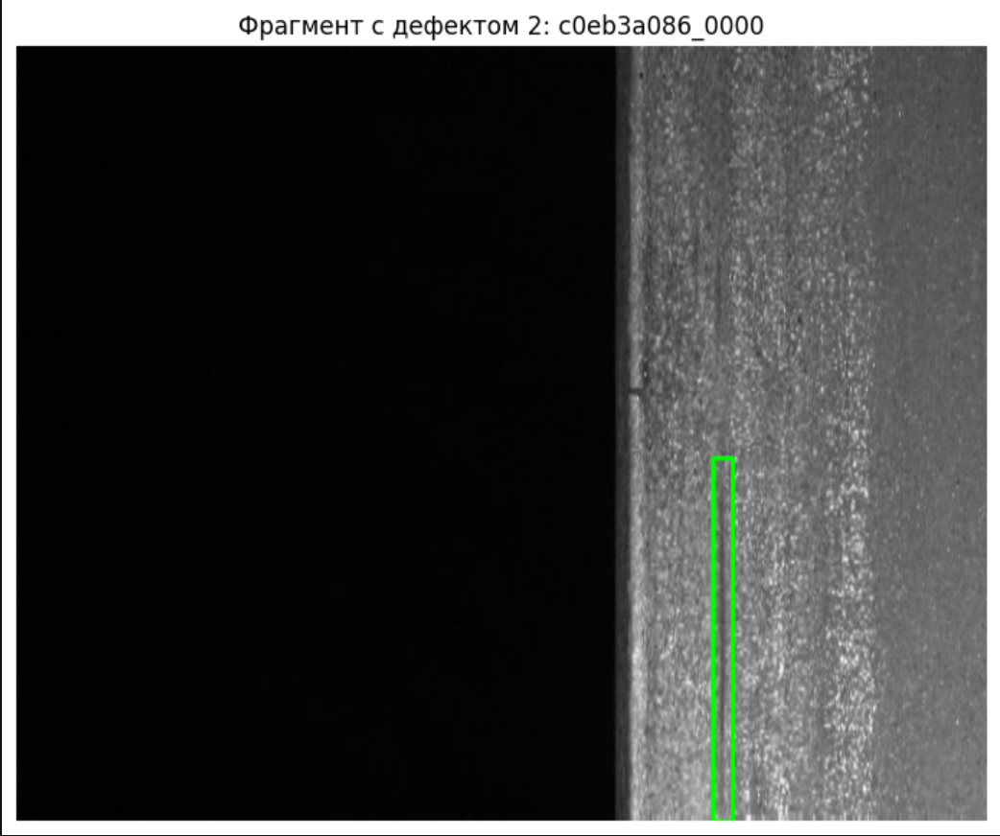

**Вывод по разметке.** На примере показан длинный узкий фрагмент дефекта, ограниченный прямоугольной рамкой. Такое преобразование позволяет обучать детектор, но теряет точную форму исходной маски; поэтому рамка может захватывать часть чистой поверхности.

---

## 3. Процесс обучения

### 3.1 Используемая модель и аппаратная среда

В обоих экспериментах использовалась предварительно обученная на стороннем наборе данных модель YOLO11, которая затем дообучалась на классах дефектов стали:

- **первый прогон:** YOLO11n — компактная модель;
- **второй прогон:** YOLO11s — модель большей ёмкости.

Обучение выполнялось в Google Colab на GPU **Tesla T4**. Использовалась библиотека Ultralytics YOLO версии 8.4.208. Предварительные веса позволяют начать обучение с уже сформированными признаками изображений, а не с полностью случайной инициализации.

YOLO — однопроходный детектор: за один проход по изображению сеть предсказывает ограничивающие рамки, класс объекта и уверенность предсказания. В отличие от классификатора изображения целиком, детектор возвращает координаты найденных дефектов.

### 3.2 Первый прогон

В первом эксперименте использовались **4 000 изображений** из полного набора. Выборка была разделена по исходным изображениям:

| Часть | Изображений |
|---|---:|
| Train | 2 800 |
| Validation | 600 |
| Test | 600 |

Изображения без дефектов оставались в наборе. В RLE-масках выделялись связные области, которые преобразовывались в прямоугольные рамки. Для обучения использовался размер входа 640×640.

Параметры первого прогона:

| Параметр | Значение |
|---|---|
| Архитектура | YOLO11n, предварительно обученные веса |
| Эпохи | до 20 |
| Batch size | 8 |
| Оптимизатор | AdamW |
| Начальный learning rate (`lr0`) | 0,001 |
| Конечный множитель learning rate (`lrf`) | 0,01 |
| Размер входа (`imgsz`) | 640 |
| Early stopping (`patience`) | 7 эпох без улучшения |
| Минимальная площадь компоненты маски | 10 пикселей |
| Seed | 42 |

В этом прогоне целое изображение подавалось модели с уменьшением до входного размера 640×640. Для исходной полосы стали с размерами около 1600×256 это значительно уменьшало высоту полезной области. Мелкие детали дефектов могли теряться, что является одним из ограничений первого эксперимента.

По графикам train- и validation-loss к концу 20-й эпохи потери продолжали снижаться. Наиболее высокий validation mAP@0.5:0.95 наблюдался в последней эпохе. Это больше соответствует недостаточному обучению, чем выраженному переобучению. В первоначальной ячейке ноутбука номер лучшей эпохи был показан как 21 из-за сдвига индекса; фактическая последняя эпоха — **20**.


### 3.3 Результаты первого прогона

**Динамика функции потерь и метрик YOLO11n**

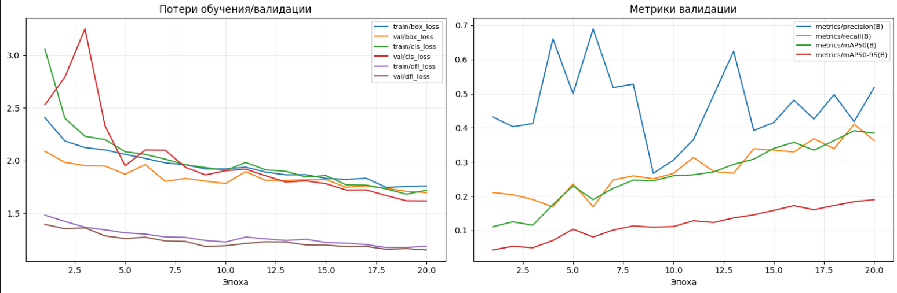

**Вывод по графику.** За 20 эпох train- и validation-loss в целом снижались, а validation mAP рос. К концу обучения метрики ещё улучшались, поэтому явного переобучения не видно; скорее, обучение остановили до полного плато. На графике заметны колебания Precision и Recall — для небольшой выборки и редких классов это ожидаемо.

К последней эпохе train/validation box-loss составляли примерно 1,758/1,695, а cls-loss — 1,717/1,615. Эти значения согласуются с графиком: обе части потерь снижались и явного расхождения train и validation не наблюдалось.

На отложенной тестовой части из 600 исходных изображений стандартный валидатор Ultralytics показал:

| Метрика | Значение |
|---|---:|
| Precision | 0,461 |
| Recall | 0,341 |
| F1-score | 0,392 |
| mAP@0.5 | 0,334 |
| mAP@0.5:0.95 | 0,152 |

AP@0.5 по классам:

| Класс | AP@0.5 |
|---|---:|
| Дефект 1 | 0,282 |
| Дефект 2 | 0,161 |
| Дефект 3 | 0,530 |
| Дефект 4 | 0,364 |

Для класса 2 стандартный Recall составил 0,063. На тесте было всего 12 изображений с этим классом, поэтому оценка особенно нестабильна.

Дополнительный расчёт по всем рамкам при пороге уверенности 0,25 дал `Precision=0,651`, `Recall=0,454`, `F1=0,535`; при пороге 0,50 — `Precision=0,840`, `Recall=0,166`, `F1=0,277`. При повышении порога модель реже выдаёт рамки: Precision растёт, но Recall падает. Эти значения рассчитаны собственным сопоставлением рамок при IoU≥0,5 и не являются напрямую сопоставимыми со стандартными macro-метриками Ultralytics.

**ROC-кривые для наличия класса на изображении**

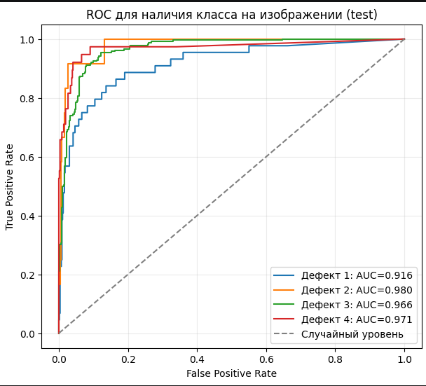

Значения ROC/AUC для определения наличия дефекта на изображении:

| Класс | AUC | Положительных изображений |
|---|---:|---:|
| Дефект 1 | 0,916 | 44 |
| Дефект 2 | 0,980 | 12 |
| Дефект 3 | 0,966 | 238 |
| Дефект 4 | 0,971 | 38 |

**Вывод по ROC-кривым.** Кривые лежат выше случайного уровня, то есть максимальная уверенность предсказаний помогает различать изображения с наличием класса и без него. Но это бинарная оценка на уровне изображения: она не подтверждает точность рамок и не противоречит более низкому mAP. Для редкого класса 2 AUC особенно нестабильна из-за всего 12 положительных примеров.

**Матрица ошибок**

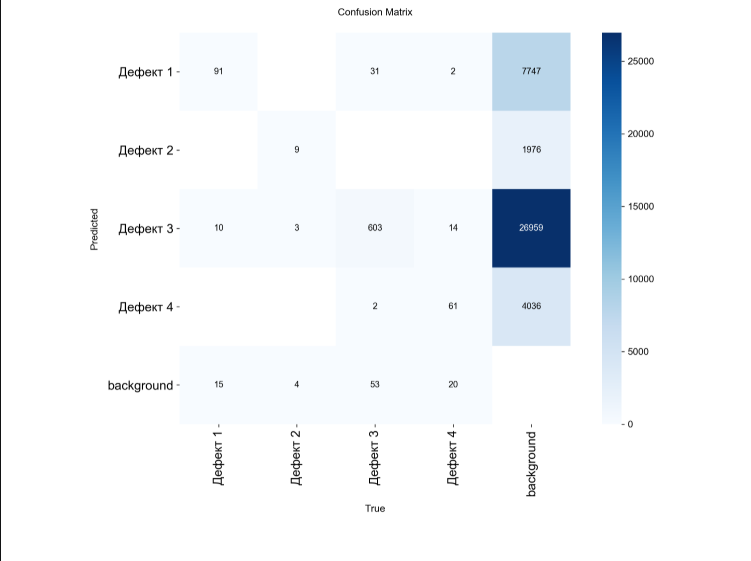

**Вывод по матрице ошибок.** Диагональные значения показывают правильно распознанные классы; ячейки background отражают несопоставленные предсказания и пропущенные рамки. Валидатор строил эту матрицу с низким порогом уверенности `conf=0,001`, поэтому большое число записей на фоне нельзя напрямую трактовать как число ложных срабатываний в локальном GUI с порогом 0,25. Матрица показывает типы ошибок, но не заменяет оценку при рабочем пороге.

**Качественный пример предсказаний**

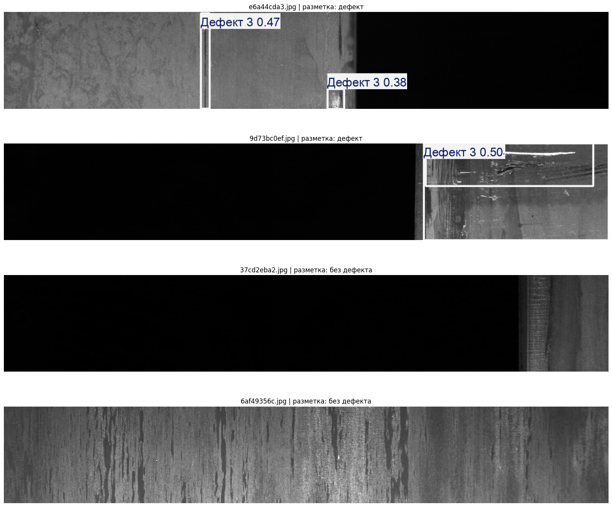

**Вывод по примеру.** Иллюстрация показывает, что модель может находить заметные области, однако отдельные рамки могут быть неточными или дублироваться. Это качественный пример, а не самостоятельное доказательство точности модели.

### 3.4 Второй прогон: основное обучение и проверка

Во втором эксперименте использовались все **12 568 исходных размеченных изображений**. Сначала исходные изображения разделялись на train, validation и test, и только после этого выполнялась нарезка на фрагменты. Такой порядок предотвращает попадание фрагментов одного исходного снимка одновременно в разные части выборки.

| Часть | Исходных изображений | Фрагментов для YOLO |
|---|---:|---:|
| Train | 10 054 | 30 668 |
| Validation | 1 257 | 3 771 |
| Test | 1 257 | 3 771 |
| **Всего** | **12 568** | **38 210** |

Разбиение выполнялось с фиксированным `seed=42` и стратификацией по редчайшему классу, присутствующему на изображении. Для редкого класса 2 к train добавлялись дополнительные обучающие фрагменты; validation и test не дублировались.

Параметры основного обучения второго прогона:

| Параметр | Значение |
|---|---|
| Архитектура | YOLO11s, предварительно обученные веса |
| Максимальное число эпох | 40 |
| Batch size | 16 |
| Оптимизатор | AdamW |
| Начальный learning rate (`lr0`) | 0,001 |
| Конечный множитель learning rate (`lrf`) | 0,02 |
| План изменения learning rate | Cosine schedule |
| Размер входа (`imgsz`) | 640 |
| Early stopping (`patience`) | 12 эпох без улучшения |
| Seed | 42 |
| Аугментации | горизонтальное отражение; небольшие изменения яркости, масштаба и сдвига |
| Mosaic / MixUp | выключены |
| `rect` | включён |

Обучение основного этапа завершилось за 40 эпох. Максимум validation mAP@0.5:0.95 был достигнут на **30-й эпохе**: `mAP50 = 0,5511`, `mAP50–95 = 0,2896`. В последних эпохах train-loss продолжал уменьшаться, тогда как validation mAP@0.5:0.95 был немного ниже пика; validation box-loss слегка вырос. Это указывает на **умеренные признаки переобучения после примерно 30-й эпохи**, но не на резкое ухудшение. Для основной проверки использовался чекпойнт `best.pt`, выбранный на validation.


#### Динамика обучения второго прогона

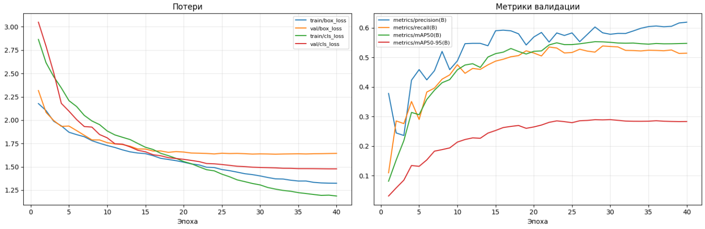

**Вывод по графику.** Train-loss продолжает уменьшаться почти до конца обучения, тогда как validation mAP достигает максимума примерно на 30-й эпохе и затем слегка снижается; validation box-loss к концу немного растёт. Это указывает на умеренное переобучение в последних эпохах. Поэтому для оценки основного этапа используется лучший чекпойнт по validation, а не автоматически последняя эпоха.

К 40-й эпохе train/validation box-loss составляли примерно 1,324/1,644, cls-loss — 1,187/1,478. Разрыв между ними вместе с небольшим снижением validation mAP после пика поддерживает вывод о лёгком переобучении, но не о резком ухудшении модели.

На отдельном test стандартный валидатор по фрагментам показал `Precision=0,646`, `Recall=0,552`, `mAP@0.5=0,600` и `mAP@0.5:0.95=0,297`. AP по каждому классу:

| Класс | AP@0.5 | AP@0.5:0.95 |
|---|---:|---:|
| Дефект 1 | 0,585 | 0,258 |
| Дефект 2 | 0,535 | 0,210 |
| Дефект 3 | 0,632 | 0,335 |
| Дефект 4 | 0,646 | 0,384 |
| **Среднее (mAP)** | **0,600** | **0,297** |

**Матрица ошибок**

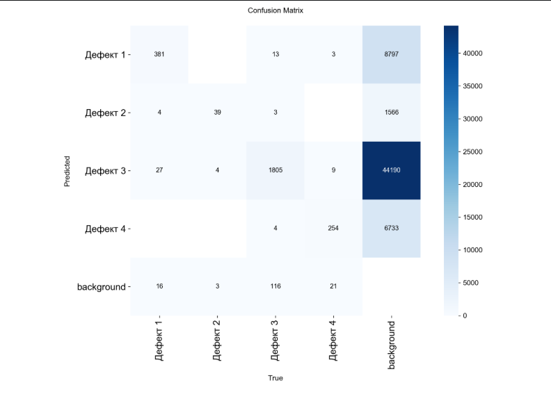

**Вывод по матрице ошибок.** Помимо правильных попаданий по диагонали, заметны записи в ячейках background, соответствующие несопоставленным рамкам и пропущенным объектам. Матрица построена валидатором с низким порогом `conf=0,001`, поэтому её фоновые значения не равны числу ложных срабатываний при пороге GUI 0,25. Для рабочей точки дополнительно приведён отдельный расчёт TP/FP/FN при пороге 0,25.

Оценка на исходных целых test-изображениях при пороге уверенности 0,25, с нарезкой и объединением перекрывающихся рамок, дала:

| TP | FP | FN | Precision | Recall | F1-score |
|---:|---:|---:|---:|---:|---:|
| 1 196 | 785 | 839 | 0,604 | 0,588 | 0,596 |

При сопоставлении учитывались рамки того же класса и IoU≥0,5. Таким образом, при выбранном пороге модель находила больше половины истинных рамок, но часть дефектов пропускала; также сохранялось заметное число ложных срабатываний.

ROC/AUC на уровне изображения для второго прогона:

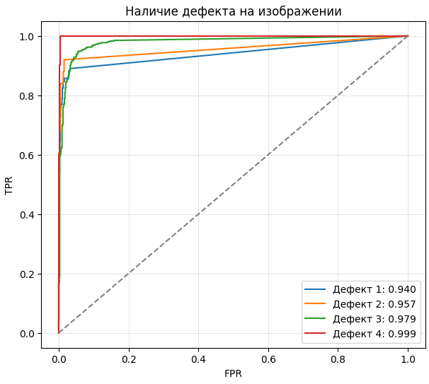

| Класс | AUC | Положительных изображений |
|---|---:|---:|
| Дефект 1 | 0,940 | 91 |
| Дефект 2 | 0,957 | 25 |
| Дефект 3 | 0,979 | 524 |
| Дефект 4 | 0,999 | 81 |

**Вывод по ROC-кривым.** Все классы имеют высокую AUC для задачи определения наличия класса на изображении. Это не означает, что координаты обнаруженных рамок точны. AUC класса 2 менее устойчива, чем AUC частого класса 3, поскольку в test присутствовало 25 положительных изображений против 524.

**Качественные примеры предсказаний**

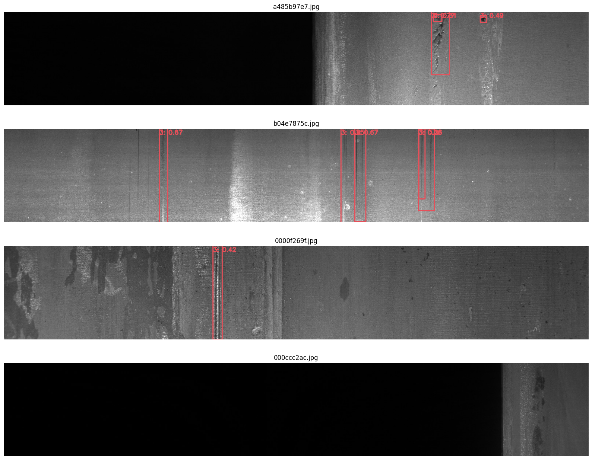

**Вывод по примерам.** На размеченных изображениях видны случаи обнаружения дефектов, но также встречаются неточные и повторяющиеся рамки. Предсказания на Kaggle `test_images` годятся для демонстрации интерфейса, однако из-за отсутствия разметки нельзя определить, являются ли они правильными.

### 3.5 Второй этап: дообучение для локального применения

После измерения метрик основного этапа train, validation и test-фрагменты были объединены, всего **38 210 фрагментов**. Чекпойнт основного этапа дообучался ещё **6 эпох** с `lr0=0,0001`, batch size 16 и без независимой валидации. Для локального применения был экспортирован файл `last.pt` этого этапа, сохранённый в проекте как `best.pt`.

Это финальное дообучение на всех доступных размеченных данных; его цель — подготовить модель для локального применения, а не провести дополнительную проверку качества.


---

## 4. Интерпретация результатов и ограничения выводов

### 4.1 Сравнение экспериментов

Во втором прогоне показатели основного этапа выше, чем в первом: mAP@0.5 увеличился с 0,334 до примерно 0,600, а mAP@0.5:0.95 — с 0,152 до примерно 0,297. Это согласуется с использованием большего набора, модели YOLO11s и нарезки изображений, сохраняющей больше деталей дефектов.

Это сравнение **ориентировочное**, а не строго контролируемое: отличаются архитектура, объём данных, геометрия входа, способ обработки изображений и test-разбиения. Поэтому по нему нельзя определить точный вклад каждого отдельного изменения.

### 4.2 Независимость тестовой оценки

Кросс-валидация в экспериментах не применялась: было выполнено одно разбиение на train/validation/test. Validation использовалась для наблюдения за обучением и выбора лучшей эпохи, test — для оценки чекпойнта основного этапа. После этого все части объединили для финального дообучения.

Таким образом, test-метрики, приведённые выше, относятся только к чекпойнту основного этапа до шести дополнительных эпох. Локальный `best.pt` уже обучался на прежнем test. Отдельная папка Kaggle `test_images` не размечена, поэтому по ней нельзя вычислить истинные метрики. У финального локального чекпойнта нет независимой количественной оценки качества.

Это не мешает использовать модель для учебной демонстрации, но ограничивает утверждения о её обобщающем качестве. Для независимой оценки понадобилась бы новая размеченная выборка, не использованная ни при обучении, ни при выборе порога и модели.

---

## 5. Тестирование и демонстрация программного обеспечения

### 5.1 Архитектура локального приложения

Локальное приложение реализовано в `local_app.py`. Для предсказания оно загружает веса YOLO и использует общую обработку изображений из `steel_pipeline.py`. Файл `model_config.json` включает режим нарезки изображения и порог уверенности по умолчанию.

Для финальной модели приложение:

1. Принимает изображение в формате BGR после преобразования из формата интерфейса.
2. Приводит изображение к высоте 256 пикселей и формирует перекрывающиеся фрагменты.
3. Выполняет предсказание YOLO на каждом фрагменте.
4. Переводит координаты рамок обратно в координаты исходного изображения.
5. Удаляет дублирующие рамки с помощью NMS.
6. Рисует рамки и возвращает названия классов и их количество.

В GUI предусмотрены три вкладки:

- **Изображение** — загрузка произвольного изображения, выбор порога уверенности и просмотр результата.
- **Видео** — загрузка видеофайла или записи с камеры, обработка заданного количества кадров и сохранение размеченного результата в MP4.
- **Камера онлайн** — отображение распознавания в потоке с веб-камеры браузера.

По умолчанию приложение открывает локальную страницу `http://127.0.0.1:7860`; публичная ссылка не включается. Для видеозаписи GUI позволяет ограничить число кадров (по умолчанию — 300), поскольку обработка зависит от скорости CPU/GPU.

### 5.2 Запуск приложения

Из папки проекта в PowerShell:

```powershell
py -m venv .venv
.\.venv\Scripts\python.exe -m pip install -r requirements-local.txt
.\.venv\Scripts\python.exe local_app.py
```

Файлы `best.pt` и `model_config.json` должны находиться рядом с `local_app.py` и `steel_pipeline.py`. Приложение может работать на CPU; при наличии совместимой NVIDIA GPU скорость может быть выше.

### 5.3 Примеры работы GUI

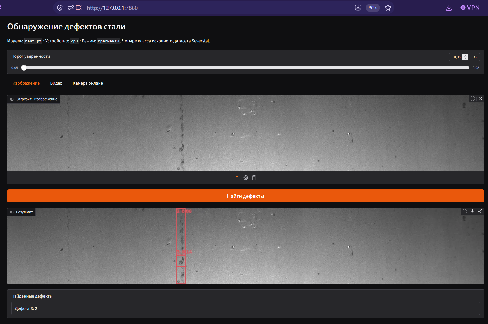


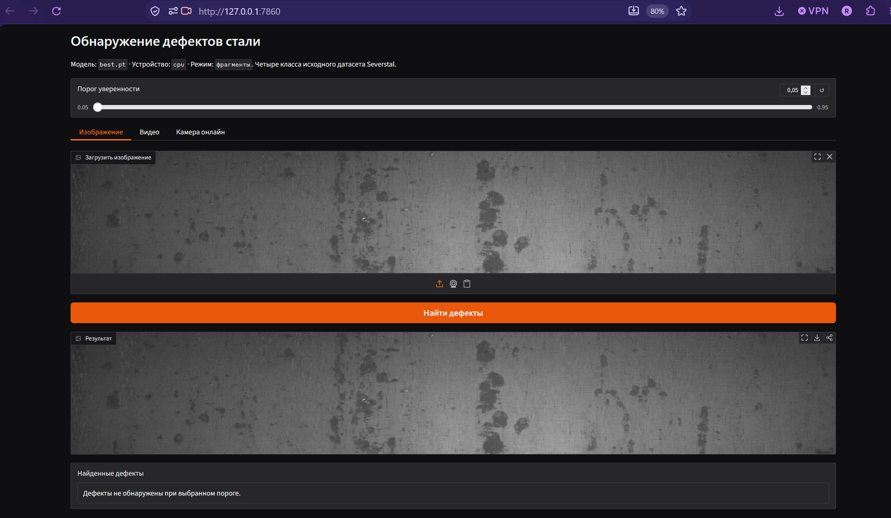


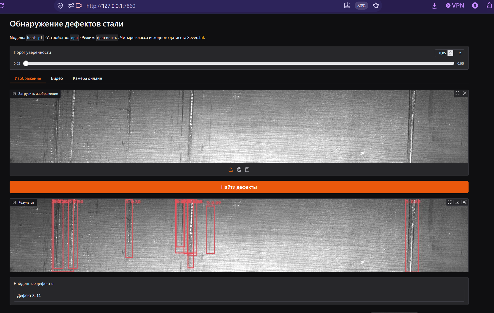

---

## 6. Заключение

В ходе работы была изучена структура процесса обучения YOLO и реализована система обнаружения четырёх классов дефектов стали. Готовые RLE-маски датасета Severstal были преобразованы в прямоугольные рамки YOLO. Проведены два эксперимента: первый — на ограниченной подвыборке с YOLO11n, второй — на полном размеченном наборе с YOLO11s и нарезкой изображений на перекрывающиеся фрагменты.

Основной этап второго прогона показал лучшие результаты среди проведённых экспериментов: `mAP@0.5 = 0,600` и `mAP@0.5:0.95 = 0,297` на отложенных test-фрагментах. Максимум validation mAP@0.5:0.95 был достигнут на 30-й эпохе; в последних эпохах наблюдалось небольшое ухудшение validation-метрики при продолжающемся снижении train-loss, что указывает на умеренные признаки переобучения.

После этой оценки модель дообучалась шесть эпох на объединённых train, validation и test-данных для локального применения. Поэтому указанные test-метрики характеризуют **модель основного этапа**, а не финальный локальный файл `best.pt`. Для последнего независимая размеченная тестовая выборка отсутствует: Kaggle `test_images` не содержит меток, а исходная размеченная test-часть была использована при финальном дообучении.

Создано локальное GUI-приложение для работы с изображениями, видео и веб-камерой. Оно выполняет ту же обработку фрагментов, что и при обучении, и накладывает предсказанные рамки на исходное изображение. Модель подходит для учебной демонстрации и предварительного выделения подозрительных областей; для оценки промышленной надёжности необходимы новые независимо размеченные изображения и проверка на данных другого оборудования и условий съёмки.
